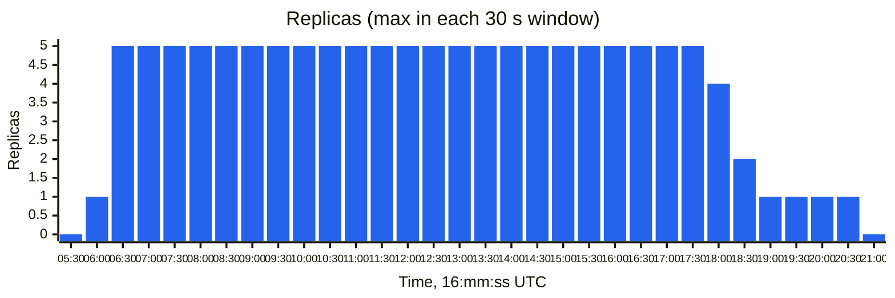
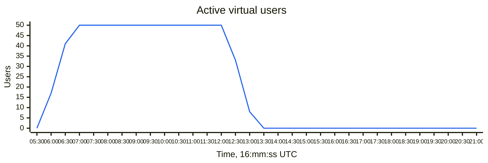
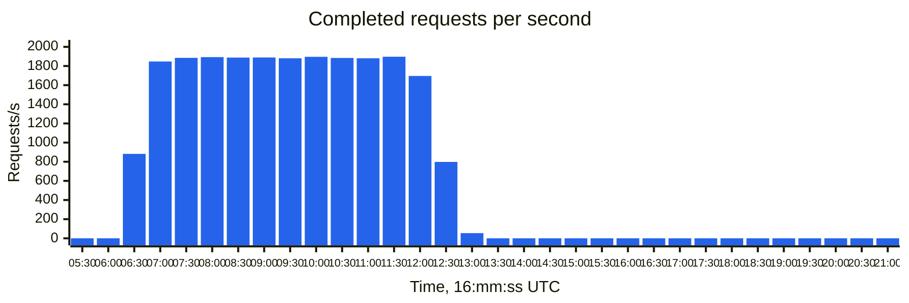
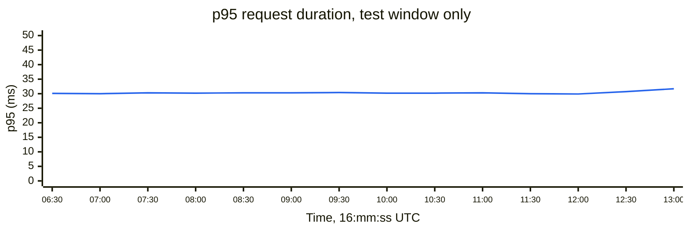

# Load test: HTTP scale rule, 2026-11-03

I ran this test to see how the HTTP scale rule on `ragsearch-api` behaves under load. The app runs in Container Apps on the Consumption profile, with a minimum of 0 replicas, a maximum of 5, and an HTTP scale rule set to 50 concurrent requests. I used k6 to send requests to `GET /api/health` from 50 virtual users, with a 1 minute ramp-up, a 5 minute hold, and a 1 minute ramp-down.

The test sent 668,177 requests with no failures. The p95 response time was 30.2 ms, the average rate was about 1,590 requests per second, and the slowest request took 29.0 s because of the cold start.

All times below are in UTC, and the charts group the data into 30 second windows.

## Timeline

```mermaid
gantt
    title Load test vs. replica lifecycle (UTC)
    dateFormat HH:mm:ss
    axisFormat %H:%M
    section k6 load
    Ramp up to 50 users       :k1, 16:06:10, 16:07:10
    Hold at 50 users          :k2, 16:07:10, 16:12:10
    Ramp down                 :k3, 16:12:10, 16:13:09
    section Replicas
    Cold start (0 to 1)       :crit, r1, 16:06:07, 16:06:24
    1 replica                 :r2, 16:06:24, 16:06:52
    Scale out (1 to 5)        :r3, 16:06:52, 16:07:14
    5 replicas                :r4, 16:07:14, 16:17:55
    Scale in (5 to 4 to 2 to 1) :r5, 16:17:55, 16:18:56
    1 replica                 :r6, 16:18:56, 16:20:31
    Scaled to zero            :milestone, r7, 16:20:31, 0s
```

## Replicas

## Load

## Latency

I left the cold start requests off this chart, since at 29 s they would flatten everything else. Those were the first 23 requests, which were sent at about 16:06:09 and didn't get a response until 16:06:38.

## Scaling events

| Time (UTC) | Event | Replicas |
|---|---|---|
| 16:06:07 | KEDA activated by incoming requests | 0 → 1 |
| 16:06:14 | Image pulled (4.8 s, 97.5 MB) | 1 |
| 16:06:24 | Container started (17 s after activation) | 1 |
| 16:06:52 | HTTP scaler rescale | 1 → 5 |
| 16:07:14 | Last of 4 new containers started | 5 |
| 16:13:09 | Last k6 request | 5 |
| 16:17:55 | Rescale: all metrics below target | 5 → 4 |
| 16:18:10 | Rescale | 4 → 2 |
| 16:18:56 | Rescale | 2 → 1 |
| 16:20:31 | KEDA deactivated | 1 → 0 |

## What the data shows

The cold start was the biggest cost in this test, at about 29 s. Between 16:06:00 and 16:06:30, 17 users were sending requests and none of them completed. This comes from setting `minReplicas` to 0. Setting it to 1 would remove the cold start, at the cost of keeping one replica running at all times.

Once the first replica was up, the scale rule went straight to the maximum of 5 replicas in one step, 45 s after activation. All of the new replicas were serving requests within 22 s.

Scaling out didn't change the response times. The p95 was 30.1 ms while only one replica was running (16:06:30 to 16:06:52), and it stayed at about 30 ms with five. Throughput leveled off at about 1,890 requests per second, which works out to 50 users divided by a round trip of about 26 ms. That means the limit was the client and the network rather than the app. This test shows that the scale rule works, but it doesn't show that the app needed five replicas to handle the load.

Scale-in started 4 min 46 s after the last request and stepped down to one replica over about a minute. The app scaled back to zero 7 min 22 s after the last request.

There were no probe failures during this run.

## Data sources

The replica counts come from the Container Apps system events, which I pulled with `az containerapp logs show --type system`. `Tests/loadtest/Results/replicas.log` shows the same values, but it trails the events by 10 to 35 s since it only polls every 10 s.

The load and latency numbers come from the k6 CSV output (`--out csv`), grouped into 30 s windows by the time each request completed.

The k6 timestamps come from my PC's clock, which was running at least 3 s ahead of Azure. By my clock, k6 started its first user at 16:06:10, but Azure logged the activation from that traffic at 16:06:07. At 30 s resolution, this doesn't affect the charts.
