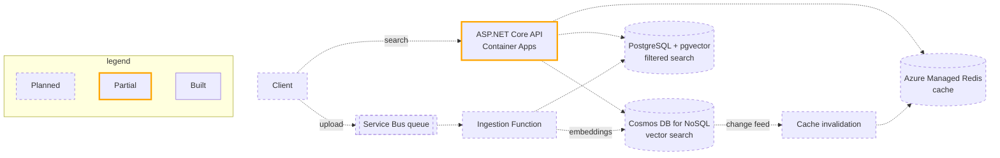
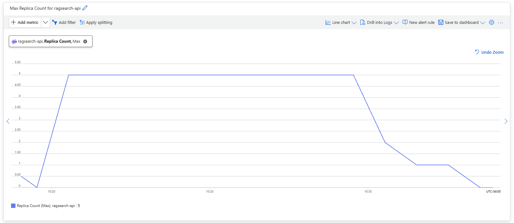
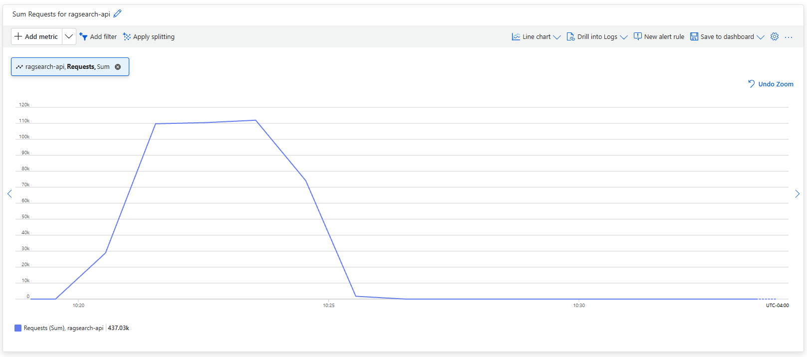

# RagSearch

RAG search API in .NET on Azure: Container Apps, Cosmos DB vector search, pgvector, Redis, Service Bus, and Functions. 

> **Status:** in active development. Everything below shows what works today and decisions I intend to make and document later.

## What it does

RagSearch is the retrieval layer of a retrieval-augmented generation (RAG) system. It ingests documents, generates embeddings, and returns the most relevant passages for a natural-language query, with optional metadata filters. New and updated documents flow through an event-driven pipeline, so search results stay current without manual reindexing.

## Architecture

Every service authenticates with managed identity. Secrets live in Key Vault, settings in App Configuration, and all components emit OpenTelemetry traces to Application Insights.

<!-- Update this diagram whenever the architecture changes. Name the embedding model once it's chosen. -->

## Status

- [x] API running in Container Apps, built with ACR Tasks, with a KEDA scale rule
- [ ] Vector search in Cosmos DB
- [ ] Change feed processor driving Redis cache invalidation
- [ ] pgvector similarity search with metadata filters
- [ ] Service Bus–triggered ingestion Function with dead-letter handling
- [ ] Managed identity, Key Vault, and App Configuration (no secrets in config)
- [ ] OpenTelemetry tracing across all services, with KQL queries below

## Design decisions 

Each section records what I chose (as they come up), what I rejected, and the trade-off I accepted.

### Container Apps over AKS and App Service
I decided against App Service to avoid paying for a service that wouldn't need to be online 24/7. Not that this project would need an expensive sku tier, but a production service likely would which would make this a good decision to make. 

<!-- Scaling needs, operational overhead, and when AKS would become the better choice. -->
<!-- ### Cosmos DB partition key 
Chosen key, expected access pattern, why it avoids hot partitions, what queries become cross-partition. -->

<!-- ### Why both Cosmos DB and pgvector
An opportunity to learn on both systems, understand tradeoffs and where both options outperform the other.  -->

<!-- ### Cache invalidation through the change feed
Why event-driven invalidation instead of TTL alone; how stale reads are bounded. -->

<!-- ### Service Bus over Event Grid for ingestion
Ordering, retries, dead-lettering, and why ingestion is a work queue rather than an event notification. -->

<!-- ### Managed idenAStity everywhere
What it removed (connection strings, secret rotation burden) and what it required. -->

## Running locally

Prerequisites: .NET SDK, Docker, and the Azure CLI.

1. Clone the repo locally.
2. configure...
3. run...

## Deploying to Azure

<!-- Infrastructure steps or IaC commands. -->
Currently I have a manual deployment process, which will be moved to a CI/CD pipeline in GitHub Actions when the process is more mature.

## Observability and Validation

### Scaling Test

I executed a load test to validate the scaling rules. See <a href='Tests/loadtest'> the scripts </a> or <a href='./Tests/loadtest/results'> the results</a>).

<!-- 2–3 KQL queries with a sentence each on what they reveal, e.g. slowest search requests, ingestion failures, cache hit rate. -->

<!-- ## Cost
Approximate monthly cost of the running deployment and the biggest cost drivers. -->

---

Built as hands-on preparation for Microsoft's AI-200 (Azure AI Cloud Developer Associate) certification.
